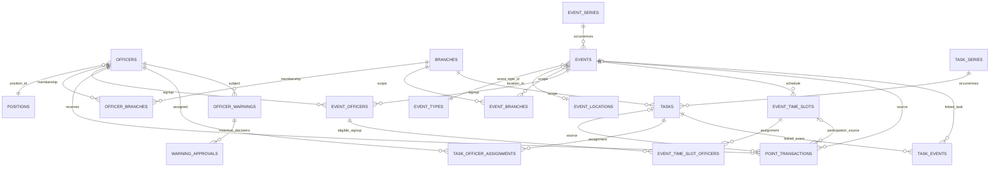

# Database relationships

This map highlights the principal foreign-key paths found in the migration chain and generated types. It is intentionally selective; the migrations define every exact constraint and deletion rule. The generated [`Database` type](../../lib/database.types.ts) exposes public table/view shapes and many relationship names, while migrations remain authoritative.

`o|`/`||` indicate optional/required participation as a conceptual aid; use each migration for the exact nullability, unique key, and `ON DELETE` action.

## Cross-domain integrity paths

- **Officer identity and scope:** `officers.position_id` references a Position; `officer_branches` provides a many-to-many Officer/Branch relation. Position machine identifiers and authorization helpers are defined in [position identity](../../supabase/migrations/20261007000000_position_machine_identity.sql), [authorization foundation](../../supabase/migrations/20260928132955_authorization_foundation.sql), and [Lead/Event scope](../../supabase/migrations/20261003030000_lead_event_branch_overlap.sql).
- **Event scope and signup:** `event_branches` scopes an Event; `event_officers` pairs an Event with an Officer. Both use composite keys. Signup write rules and trusted mutations are in [Event management](../../supabase/migrations/20260927011257_event_management.sql), [final RLS](../../supabase/migrations/20260928140107_final_rls.sql), and the later [Event signup lifecycle](../../supabase/migrations/20261019190000_remove_event_waitlist_contracts.sql).
- **Time Slot participation:** an assignment references `(slot_id, event_id)` and `(event_id, officer_id)`, ensuring that the assigned Officer has that Event signup and the slot belongs to that Event. A slot-linked Point references `(event_time_slot_id, event_id)` as a composite foreign key. These constraints are in [Event Time Slots](../../supabase/migrations/20261020120000_event_time_slots.sql).
- **Source-derived Points:** `point_transactions` links an Officer and optionally its Event, Event Time Slot, or Task source. Checks and partial unique indexes constrain valid source/award combinations; source reconciliation functions preserve history. See [Event participation reconciliation](../../supabase/migrations/20261030043612_reconcile_event_participation.sql), [Task assignment awards](../../supabase/migrations/20261004000000_task_officer_completion_workflow.sql), and [independent manual Points](../../supabase/migrations/20261029233906_independent_manual_points.sql).
- **Tasks and Events:** `task_events` is a many-to-many link, independent of Task assignment and completion. It is defined in [Task/Event links](../../supabase/migrations/20261008170000_task_event_links.sql); a link does not replace either source entity's foreign keys or lifecycle.
- **Recurring occurrences:** `event_series`/`task_series` identify recurrence definitions; each occurrence keeps its own Event/Task ID and carries a paired series ID/key protected by a unique index. Scoped mutations are supported by [recurring scopes](../../supabase/migrations/20261003042248_recurring_series_scopes.sql) and [recurrence Delete/Restore](../../supabase/migrations/20261031120000_recurrence_delete_restore.sql).
- **Warnings and audit attribution:** warnings reference their subject Officer, while audit and actor columns may preserve Officer attribution. Warning approval history uses a composite key. Relevant constraints/policies appear in [warning lifecycle](../../supabase/migrations/20260929041159_warning_lifecycle.sql), [stable Officer actor attribution](../../supabase/migrations/20261003214231_stable_officer_actor_attribution.sql), and [warning recovery](../../supabase/migrations/20261030180000_recoverable_warning_deletion.sql).

## Authorization boundary

Foreign keys protect relational integrity; they do not grant permission. RLS, grants, and trusted mutation functions enforce access. The central active-Officer read model and revocation of direct client writes are in [final RLS](../../supabase/migrations/20260928140107_final_rls.sql); domain-specific policies are defined alongside tables and in later migrations. Review the applicable policies and function privilege/search-path definitions before drawing an authorization conclusion.
